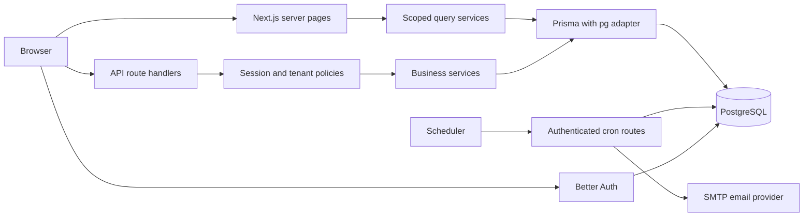

# System architecture

FixFlow is one Node.js Next.js application backed by PostgreSQL. It uses the App
Router, server-rendered route entry points, client form components and route
handlers. There is no separate API deployment or in-memory business data store.

## Code map

| Location | Responsibility |
| --- | --- |
| `src/app` | Public and role route entry points, loading/error boundaries, API |
| `src/components` | Responsive shell, workspace views, accessible dialogs/forms |
| `src/lib/auth.ts` | Better Auth adapter, password recovery, session/rate-limit configuration |
| `src/server/policies.ts` | Active user and membership checks, tenant query scopes |
| `src/server/services` | Booking, repairs, finance, query projections, staff and dispatch services |
| `src/server/rules.ts` | Slot/overlap rules, transitions, integer totals, reminder state |
| `prisma` | Relational schema, ordered SQL migrations, development-only seed |
| `tests` | Unit rules, PostgreSQL integration workflows, browser/API checks |

## Trust boundaries

Pages and API handlers load the actor from a database-backed session. Memberships
are refreshed from the database and restricted to active centers. Hidden UI is
not authorization: each business mutation validates ownership, assignment or
manager membership. Administrators manage platform access but do not implicitly
read customer repair or financial records. Technician projections exclude prices,
invoices and estimates.

Mutation requests require the configured application Origin. Better Auth owns
authentication endpoint CSRF handling and database rate limiting. Cron routes
instead use a separate bearer secret with timing-safe comparison. Zod validates
input. Errors expose expected validation messages and generic unexpected failures,
not Prisma internals. Private responses disable shared caching.

Serializable transactions coordinate booking capacity, stock, approvals, payments
and workflow changes. Conflicting transactions return a retryable conflict rather
than permitting inconsistent state. Request keys prevent duplicate booking,
stock and payment submissions. Unique constraints enforce one work order per
appointment, one invoice per work order and one generated reminder per source.

Notifications are persisted with business operations; a separate scheduler sends
email with leases and three attempts. A provider accepting a message is recorded
as ACCEPTED, not proof of delivery. SMTP cannot guarantee exactly-once delivery
if a worker crashes after provider acceptance but before recording success.

## UI and scale

Workspace lists use pages of 20. Selectors and public center results are bounded
at 100; detailed vehicle history displays the latest 50 records. Work detail
refreshes every 30 seconds. Reports use database aggregates, including monthly
revenue and appointment counts. There is no WebSocket infrastructure or external
analytics service. Larger deployments need dedicated paginated lookup endpoints,
load tests, queue monitoring and provider delivery webhooks.
