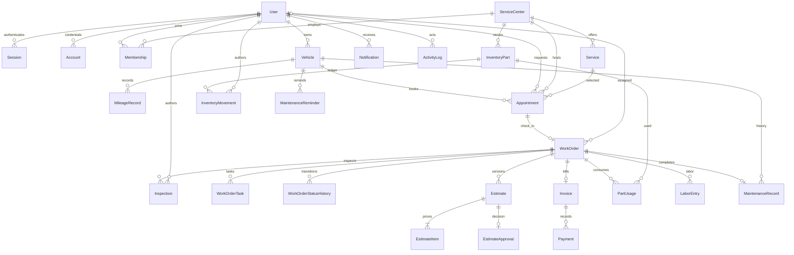

# Database design

PostgreSQL is the source of truth. Prisma 7 generates its client in
`generated/prisma`; do not edit generated files. `prisma/schema.prisma` defines
relations and indexes. SQL migrations also contain CHECK constraints that are
not fully represented by Prisma schema syntax.

Authentication also uses `Verification` (reset tokens) and `RateLimit` tables.
The diagram omits some secondary foreign keys for readability; the schema is
authoritative.

## Integrity

- Unique normalized vehicle registration; owner relation and retained mileage readings.
- Membership uniqueness per user/center; active flags revoke access without deletion.
- Appointment duration, center capacity, stock, quantities and financial values have
  database constraints. Capacity/vehicle overlap requires serializable service checks.
- Version uniqueness per work order. Decisions belong to a specific estimate;
  prior approved estimates remain immutable when a new version is issued.
- Money uses integer minor units; tax rates use basis points. Calculations use
  explicit integer rounding and enforce supported maximum totals.
- Invoice snapshots preserve customer, workshop, line items and totals at issue time.
- Inventory movements and payments have unique request keys. No negative stock or
  overpayment is permitted by the service layer.
- Inspection and inventory movement authors now have enforced User foreign keys.

## Migrations

| Migration | Purpose |
| --- | --- |
| `20261011150819_initial` | Base domain and authentication tables |
| `20261011151925_notification_email_queue` | Email states, attempts and leases |
| `20261011154000_integrity_constraints` | Business CHECK constraints |
| `20261012051836_center_approval_and_authorship` | Approval timestamp and author foreign keys |

The approval migration marks existing active centers approved at their creation
time, preserving their operation. New API-created centers start inactive and
pending approval. Suspension retains the previous approval timestamp.

Run `npm run db:generate`, `npm run db:migrate`, and `npx prisma migrate status`.
Use `prisma migrate dev --name descriptive_name` only on a disposable development
database when authoring a migration. Review generated SQL. Never use reset or
`db push` on shared/production data. Back up before deployment and test restoration.
