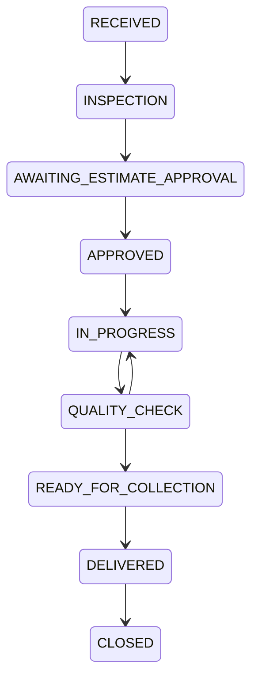

# Roles and business workflows

| Capability | Customer | Technician | Manager | Administrator |
| --- | --- | --- | --- | --- |
| Register vehicles/book/approve estimates | Own records | No | Manage center bookings | No |
| Read repair jobs | Own | Assigned at active membership | Own centers | No implicit access |
| Inspect, tasks, repair progress | Read | Assigned jobs | Own centers | No |
| Consume parts | No | Assigned approved repairs | Own centers | No |
| Prices, estimates, invoices, payments | Own read/decision | No | Own centers | No |
| Final quality clearance/delivery/closure | No | No | Own centers | No |
| Catalog, inventory, technician membership | No | No | Own centers | No implicit access |
| Center approval, manager creation, user suspension | No | No | No | Yes |
| Platform audit logs | No | No | No | Yes |

The initial administrator is created with the bootstrap CLI. Public registration
always creates a customer, ignoring submitted privileged roles. Administrators
create managers for a center; managers create technicians for their own centers.
Manager membership is required for operational access even for an administrator.

## Complete service journey

1. Customer registers/logs in and adds a vehicle. Registration is normalized and
   unique; normal mileage changes cannot decrease the reading.
2. Customer selects an active center/service and requests an available half-hour
   slot within opening days, closures and the booking horizon. Capacity and
   overlapping bookings for the same vehicle are checked transactionally.
3. Manager confirms the appointment, then checks in the vehicle. Check-in creates
   one work order; a technician must be an active member of that center.
4. Assigned technician enters inspection results and tasks. Manager issues a
   versioned estimate. The owner approves or rejects that exact unexpired version.
5. Repairs require the current approved estimate. A replacement estimate requires
   renewed approval. Parts consumption records stock and usage atomically.
6. Technician completes tasks and moves to quality check. Manager performs final
   clearance. Ready-for-collection creates one service history entry and a
   reminder from the service's kilometer/month intervals.
7. Manager issues an immutable invoice from the approved estimate. Payments are
   recorded with unique request keys; overpayment is rejected. The owner can
   download the restricted invoice PDF.
8. Manager records delivery, then closes the job after payment requirements are
   satisfied. History and reminders remain available to the owner.

Early stages also support cancellation. Estimate decisions control approval-stage
transitions; clients cannot bypass them with a direct status request. Reminders
become upcoming within 500 km or 30 days; either threshold can trigger a notice.
They are advisory based on the latest recorded mileage, not telematics.

## Current boundaries

Manager technician membership editing supports activation and specializations.
Arbitrary role promotion, moving an existing manager between centers and custom
permission editing are not exposed. Invoice voiding supports unpaid invoices;
credit notes, refunds and replacement invoice issuance are not implemented.
Estimates are issued versions, without a separate autosaved draft editor.
Attachment uploads, live payment gateways, SMS, custom date report exports and
live GPS/vehicle telemetry are outside the implemented feature set.
Managers can download the existing monthly revenue/appointment report as CSV.
